# IE350 · Hidrômetro digital com RSSF LoRa

Trabalho final da disciplina IE350 (Redes de Comunicação Sem Fio para IoT, FEEC/UNICAMP),
feito com a Metodologia das Três Fases (TpM) e a plataforma Smart TpM.

Autor: Lucas Chiomark Pereira Santos · RA 195111

## Objetivo

Verificar se uma rede LoRa atende a leitura individual de hidrômetros em um prédio
residencial antigo (térreo + 4 andares, com elevador). O elevador é usado de propósito como
perturbação: a cabine metálica e o contrapeso se movem no poço e alteram o canal. Para cada
cenário medimos RSSI, SNR e taxa de sucesso de pacotes (PSR) na descida (DL) e na subida (UL).

## Organização do repositório

| Pasta | Conteúdo |
|---|---|
| `framework_dlul/` | Framework de cobertura DL/UL via MQTT, níveis N1 a N6 (usado em todas as medidas) |
| `teste_ul/` | Primeiro teste, só de uplink, usado para validar o hardware |
| `gerencia/node-red/` | Painel Node-RED que acompanha a rodada em tempo real |
| `dados/brutos/` | Arquivos de cada rodada, sem edição, uma pasta por campanha |
| `dados/processados/` | `resumo_rodadas.csv`, gerado pelos scripts de análise |
| `analise/` | `resumo_rodadas.py` (estatísticas), `graficos.py` (resultados) e `ilustracoes.py` (corte e plantas) |
| `docs/` | Guia e cronograma, roteiro dos ensaios, figuras e fotos do ensaio |

## Framework DL/UL

```
N6 tela LoRa Site Survey ─┐
N2/N3 Python (PC) ── MQTT (broker.hivemq.com) ── Gateway NodeMCU ── LoRa ── Nó NodeMCU
N5 processamento ─────────┘        │
                     3_N4_Armazenamento/Dados_Brutos (1 .txt por rodada)
```

A cada medida, o script Python publica um pacote de descida no broker. O gateway transmite
esse pacote por LoRa, o nó responde com a RSSI e o SNR que mediu na descida, e o gateway
acrescenta a RSSI e o SNR da subida. O broker é público, então o PC e o gateway só precisam
de internet; não precisam estar na mesma rede.

| Nível | Arquivo | Função |
|---|---|---|
| N1/N2 | `0_N1_N2_No_Sensor/no_sensor_dlul/` | Nó sensor: responde cada DL com a RSSI e o SNR medidos |
| N2 | `1_N2_Gateway/gateway_dlul/` | Gateway: ponte entre MQTT e LoRa |
| N2/N3 | `2_N2_N3_Borda/N2_N3_LSS_MQTT.py` | Envia os DL, recebe os UL e grava a rodada |
| N4 | `3_N4_Armazenamento/` | Parâmetros, dados brutos e processados |
| N5 | `4_N5_Processamento/N5_Gerencia_SNR.py` | Calcula RSSI, SNR, PSR e taxa de canal |
| N6 | `5_N6_Exibicao/N6_Gerencia_SNR_Radio.py` | Tela que configura o rádio, dispara a rodada e mostra o resultado |

### Configuração usada

| Item | Valor |
|---|---|
| Rádio | 903 MHz · SF12 · BW 125 kHz · CR 4/8 · 20 dBm |
| Sensibilidade (SF12/125 kHz) | −137 dBm, usada para calcular a margem |
| Intervalo entre medidas | ≈ 4 s, calculado pelo framework a partir do tempo no ar |
| Broker | `broker.hivemq.com:1883`, QoS 0 |
| Tópicos | `mot_lora_195111/gateway/downlink` e `mot_lora_195111/gateway/uplink` |

### Bytes do UL

| Byte | Conteúdo | Conversão |
|---|---|---|
| 0 | RSSI do DL, medida no nó | `b/2 − 74` dBm (se b > 128, subtrair 256 antes) |
| 1 | SNR do DL | `b/4 − 30` dB |
| 2 | RSSI do UL, medida no gateway | igual ao byte 0 |
| 3 | SNR do UL | igual ao byte 1 |

Quando o pacote se perde, os bytes do UL são gravados com o valor 9.

### Pinagem (NodeMCU e RFM95)

| RFM95 | NodeMCU | GPIO |
|---|---|---|
| SCK / MISO / MOSI | D5 / D6 / D7 | 14 / 12 / 13 |
| NSS | D8 | 15 |
| RESET | D3 | 0 |
| DIO0 | D1 | 5 |
| LED vermelho / verde (nó) | D4 / D2 | 2 / 4 |

### Como rodar

1. Instale no Arduino IDE o pacote ESP8266 e as bibliotecas LoRa (Sandeep Mistry) e MQTT (Joel Gaehwiler).
2. No gateway, copie `secrets_exemplo.h` para `secrets.h` e preencha a rede Wi-Fi 2.4 GHz do local. O `secrets.h` fica fora do git.
3. Grave `no_sensor_dlul` e `gateway_dlul` com a placa NodeMCU 1.0. Os dois já vêm com `PKLORA_NODEMCU` selecionado.
4. No PC, rode `pip install paho-mqtt pandas matplotlib`.
5. Abra dois terminais dentro das pastas dos scripts, porque os caminhos são relativos:
   `cd framework_dlul/2_N2_N3_Borda && python N2_N3_LSS_MQTT.py` e
   `cd framework_dlul/5_N6_Exibicao && python N6_Gerencia_SNR_Radio.py`.
6. Na tela N6, confira a configuração e clique em INICIAR. A rodada é gravada em
   `3_N4_Armazenamento/Dados_Brutos/`. Copie o arquivo para `dados/brutos/` com o nome padrão
   `R_<rodada>_<posicaoNo>_<posicaoGW>_<condicao>_<AAAA-MM-DD_HH-MM>.txt`.
7. Para refazer as tabelas e figuras: `python analise/resumo_rodadas.py`,
   `python analise/graficos.py` e `python analise/ilustracoes.py`.

O painel Node-RED (`gerencia/node-red/`) é opcional. Ele assina o mesmo tópico de UL e mostra
a rodada em tempo real; o README da pasta explica a importação.

## Como os ensaios foram feitos

O gateway ficou sempre no mesmo lugar: na parede interna do apartamento do 2º andar, ao lado
da porta, ligado no Wi-Fi do apartamento. Quem mudou de posição foi o nó. O canal de rádio é
recíproco, então "nó no térreo e gateway no 2º" mede o mesmo enlace que "gateway no térreo e
nó no 2º", que era o plano original. Medimos DL e UL em todas as rodadas; com o nó na tomada, as duas
direções ficaram a no máximo 2,5 dB uma da outra, o que sustenta a troca.

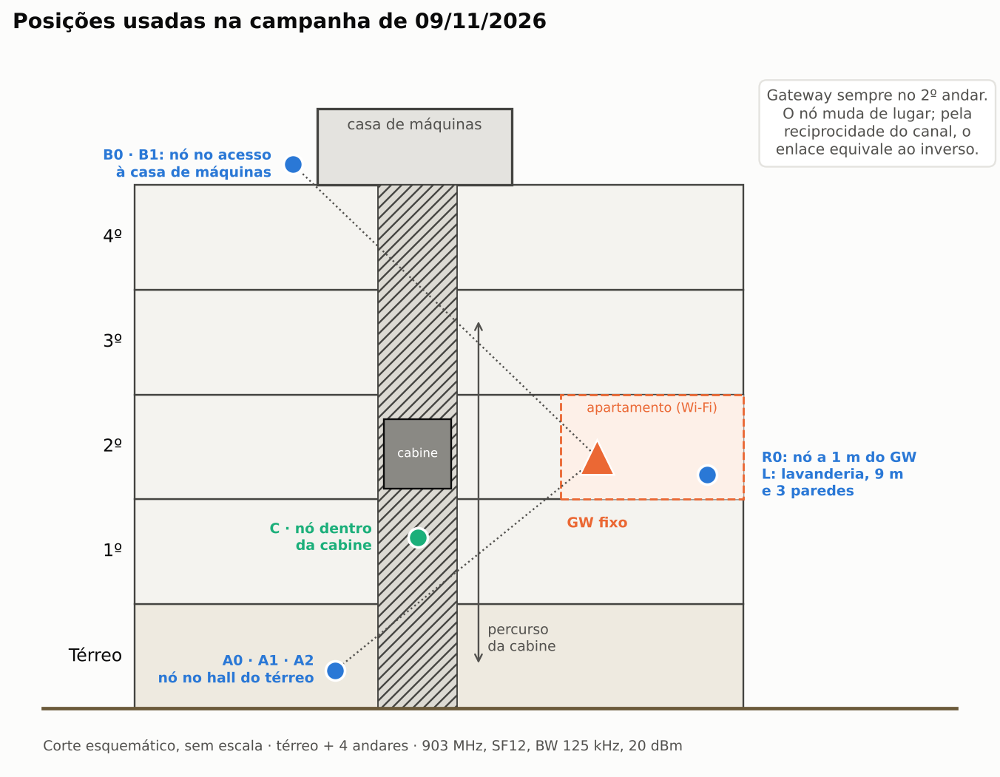

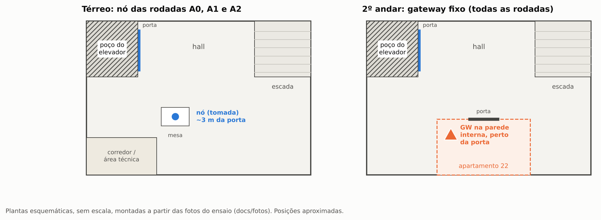

Cada rodada do prédio teve 50 medidas (cerca de 3,5 min), com o nó ligado na tomada. O
elevador foi chamado à mão. Nas rodadas com movimento, o percurso foi registrado em vídeo com
um relógio no quadro, para alinhar cada medida com a posição da cabine.

| Fotos | |
|---|---|
| 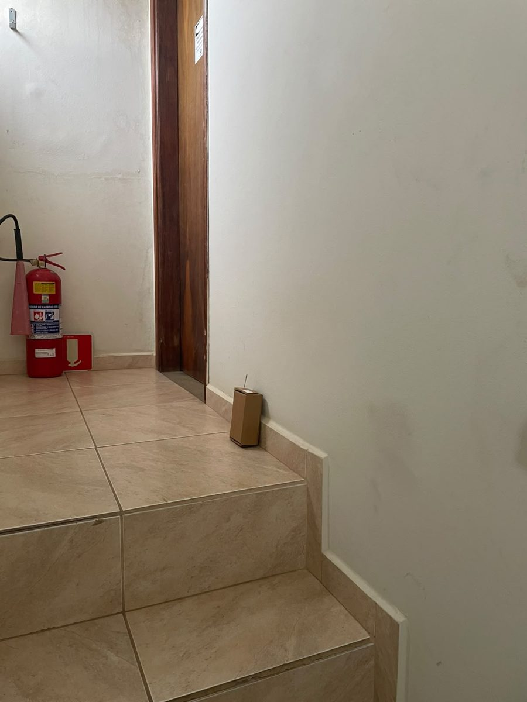 | 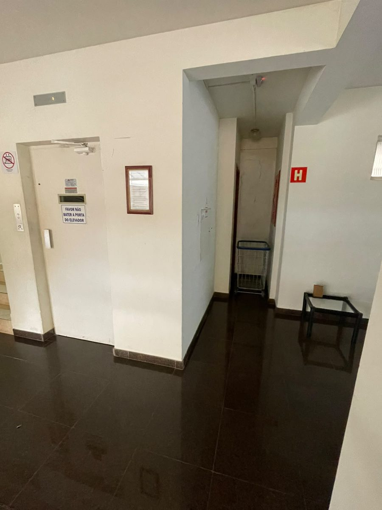 |
| Nó no acesso à casa de máquinas (B0, B1) | Nó no hall do térreo, ao lado do elevador (A0, A1, A2) |
| 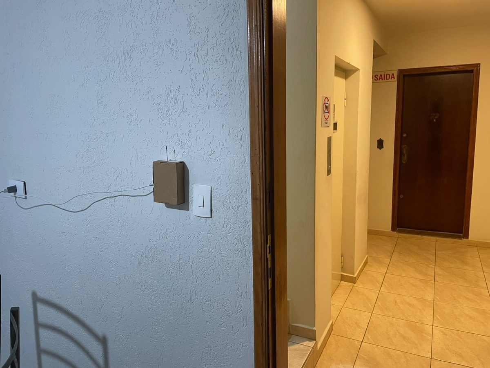 | 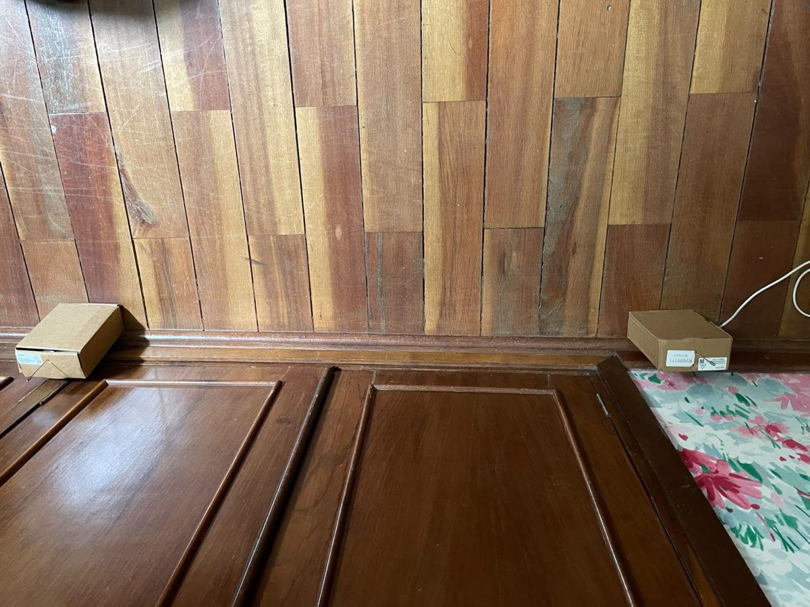 |
| Gateway fixo no 2º andar | Referência a 1 m (R0) |
| 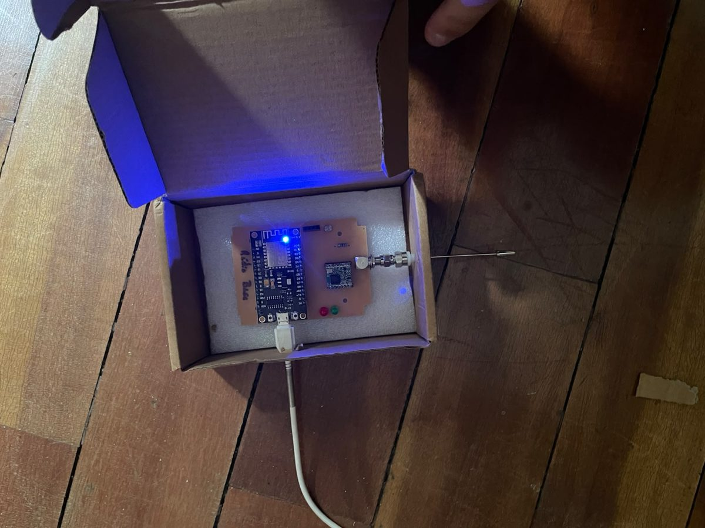 | 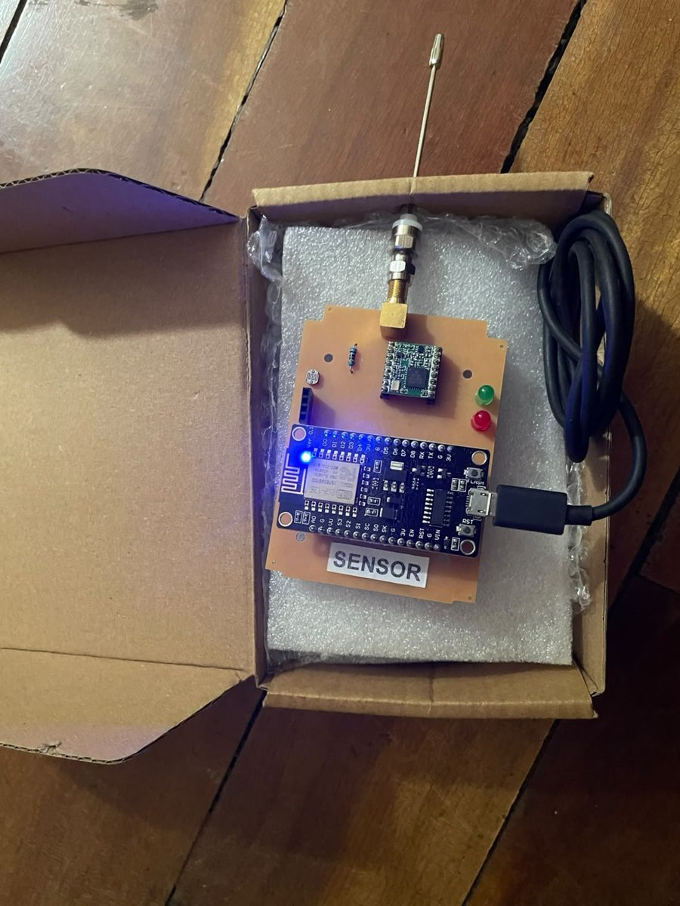 |
| Gateway: NodeMCU + RFM95 | Nó sensor: NodeMCU + RFM95 |

## Rodadas

Todas em SF12 / BW 125 kHz / CR 4/8 / 20 dBm. Valores médios em dBm; σ é o desvio padrão.
A margem é a RSSI média do UL menos a sensibilidade (−137 dBm).

| Rodada | Onde estava o nó | Elevador | PSR | RSSI UL | σ UL | RSSI DL | σ DL | Margem |
|---|---|---|---|---|---|---|---|---|
| R0 | 1 m do GW, antenas verticais | n/a | 99% | −43,0 | 0,63 | −40,5 | 0,54 | 94 dB |
| R0H | 1 m do GW, antenas ponta a ponta | n/a | 100% | −42,7 | 0,61 | −42,7 | 0,55 | 94 dB |
| L1 / L2 | lavanderia, 9 m e 3 paredes | n/a | 100% | −77,5 / −76,8 | 0,4 / 1,1 | −75,3 / −76,0 | 0,7 / 1,2 | 60 dB |
| A0 | hall do térreo | parado | 100% | −78,2 | 0,59 | −77,1 | 0,33 | 59 dB |
| A1 | hall do térreo | em movimento | 100% | −79,0 | 3,77 | −77,9 | 4,68 | 58 dB |
| A2 | hall do térreo | parando em cada andar | 100% | −79,2 | 4,49 | −77,7 | 4,58 | 58 dB |
| B0 | acesso à casa de máquinas | parado | 100% | −75,6 | 0,72 | −75,4 | 0,83 | 61 dB |
| B1 | acesso à casa de máquinas | em movimento | 100% | −79,1 | 2,90 | −79,6 | 2,72 | 57 dB |
| C (7 a 33) | dentro da cabine | em percurso | 100% | −72,4 | 5,1 | −71,7 | 6,2 | 65 dB |
| A0pb | hall do térreo, power bank | parado | 100% | −95,6 | 1,55 | −94,9 | 1,70 | 41 dB |
| B0pb | casa de máquinas, power bank | parado | 100% | −104,4 | 7,24 | −93,9 | 2,88 | 33 dB |

Rodadas de apoio, com nó e gateway lado a lado: P1 a P5 (01/10, 2,5 m, 100 medidas cada) e
V1 a V7 (09/11, mesma mesa, 20 medidas cada). V1 a V6 tiveram PSR de 100%. Na V7 o gateway
estava no 4G do celular e o PSR caiu para 70% com o rádio em −40 dBm. O resumo completo está
em `dados/processados/resumo_rodadas.csv`.

## Resultados

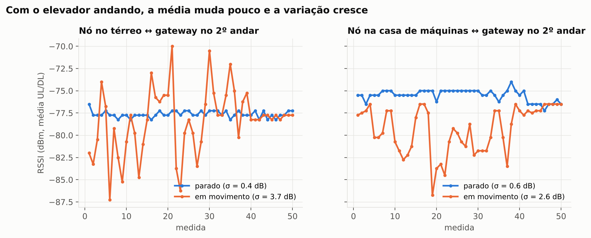

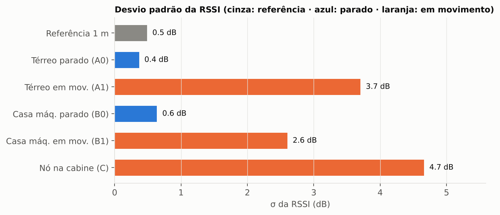

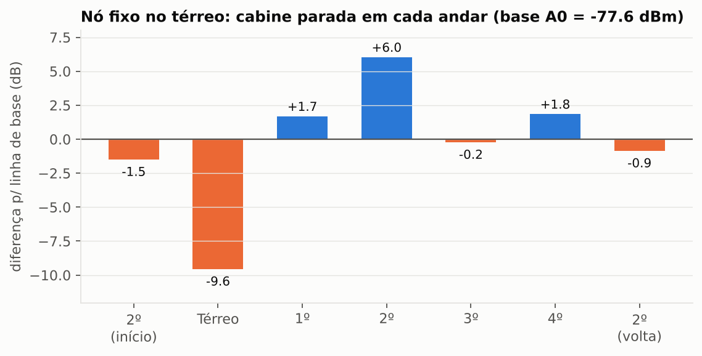

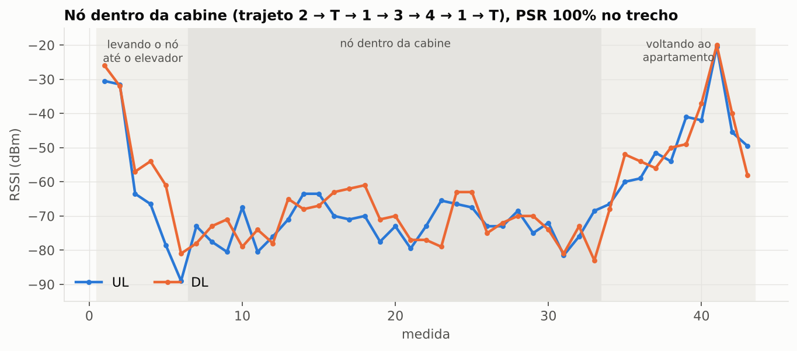

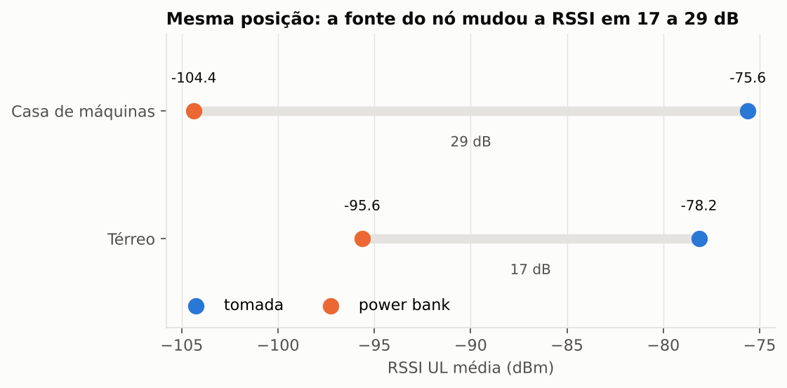

## Conclusões

1. O elevador em movimento não muda a média, mas aumenta muito a variação. No térreo, o σ do
   UL passou de 0,59 dB (A0) para 4,25 dB nas medidas com a cabine andando (A1); no DL, de
   0,33 para 5,31 dB. No acesso à casa de máquinas o σ subiu cerca de 4 vezes (B0 para B1). As
   médias mudaram no máximo cerca de 4 dB.
2. O pior caso no térreo acontece com a cabine parada no próprio térreo: a RSSI cai cerca de
   9,6 dB em relação à base. Com a cabine nos andares acima, a variação fica em torno de ±2 dB.
3. Mesmo nos piores pacotes (RSSI mínima de −94 dBm em A1), a margem continua acima de 40 dB e
   o PSR foi de 100% em todas as rodadas do prédio com o nó na tomada. Para esse prédio, a
   cobertura com um único gateway no 2º andar é suficiente.
4. Essa margem sugere que um SF menor também atenderia, com menos tempo no ar e menos consumo.
   Esse é o ponto de partida da etapa de gerência.
5. A fonte importa mais que o elevador. Com power bank, o mesmo ponto ficou 17 dB (térreo) a
   29 dB (casa de máquinas) abaixo da medida com tomada. Na B0pb o power bank estava desligando
   e o UL ficou bem pior que o DL. A causa provável é a perda do plano de terra do cabo USB ou
   ruído da fonte, junto com o desligamento automático do power bank por corrente baixa.
6. A orientação das antenas a 1 m mudou até cerca de 2 dB, dentro do ruído de medida.
7. Com R0 (1 m) como referência, a lavanderia (9 m e 3 paredes) dá expoente de perda
   β ≈ 3,6. Se considerarmos β = 2 para o espaço livre, sobram cerca de 5 dB por parede.
8. As perdas de pacote vistas fora do prédio vieram da rede, não do rádio. Com o gateway no
   4G, o atraso passa da janela de espera do script N2/N3 (cerca de 2 s de pausa e 4 s de
   espera) e o pacote conta como perdido. Por isso todas as rodadas válidas usaram o Wi-Fi do
   apartamento.

## Limitações

- A rodada C é exploratória. Ela usou power bank e o cabo soltou na medida 44, então as
  medidas 44 a 50 não valem e o PSR bruto de 88% está distorcido. A tabela usa as medidas 7 a
  33. O percurso da cabine (2, T, 1, 3, 4, 1, T) foi reconstruído pelas fotos e pelo painel.
- Os horários de cada trecho do percurso em A1, A2, B1 e C foram estimados pelo vídeo e pelo
  painel; podem ter erro de uma ou duas medidas.
- A rodada preliminar das 13:15 (nó no térreo, gateway no quarto) ficou só no CSV exportado
  pelo painel (`PRE_...csv`); o `.txt` do framework não foi salvo.
- O prédio tem só 4 andares e as posições são de um único dia. As plantas são esquemáticas e
  sem escala.

## Teste de uplink (UL)

Primeiro experimento, só de subida: o nó envia a leitura do LDR a cada segundo e o gateway
entrega o pacote e a RSSI ao PC pela USB (`teste_ul/UL_Test.py` mostra os gráficos). Usa a
mesma pinagem do framework, em 903 MHz, SF7 e 17 dBm. Não grava arquivo.

## Créditos

O framework DL/UL "MoT LoRa Site Survey" (WissTek IoT: Branquinho, Felipe e Anderson) e o
teste UL (kit PK-LoRa V2, WissTek IoT) são materiais da disciplina, e os créditos originais
estão mantidos nos arquivos. Neste repositório, Lucas Chiomark Pereira Santos fez a adaptação
para NodeMCU, os tópicos e credenciais, o painel Node-RED, os scripts de análise, a
documentação e a campanha de medidas.

## Andamento

- [x] Fase 1 (negócio) e Fase 2 (requisitos) na Smart TpM
- [x] Fase 3: tecnologias e planilha de projeto
- [x] Teste de uplink com ESP8266
- [x] Framework de cobertura DL/UL via MQTT e medidas preliminares
- [x] Campanha de medidas no prédio (09/11)
- [ ] Framework de gerência (30/11)
- [ ] Apresentação (07/12 ou 14/12)
