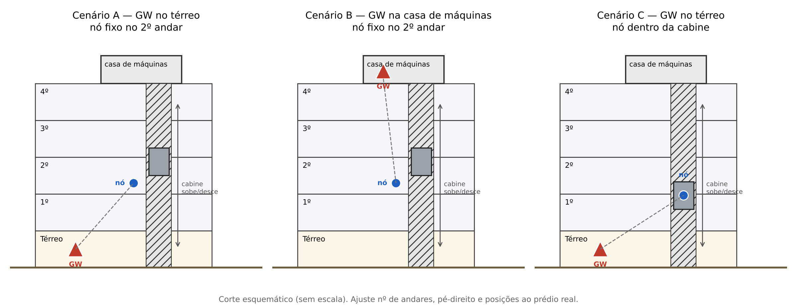

# IE350 · Hidrômetro digital com RSSF LoRa

Projeto da disciplina **IE350 – Redes de Comunicação Sem Fio para IoT** (FEEC/UNICAMP),
desenvolvido com a **Metodologia das Três Fases (TpM)** e a plataforma Smart TpM.

**Autor:** Lucas Chiomark Pereira Santos · RA 195111

## Objetivo

Avaliar a cobertura e gerenciar uma rede de sensores sem fio LoRa para medição
individualizada de água em um prédio residencial. O ambiente é perturbado de propósito
com o **elevador em movimento**, para medir o impacto em RSSI, SNR e taxa de sucesso de
pacotes (PSR).

## Cenários de teste



| Rodada | Gateway          | Nó              | Elevador                    |
|--------|------------------|-----------------|-----------------------------|
| A0     | Térreo           | 2º andar, fixo  | Parado (linha de base)      |
| A1     | Térreo           | 2º andar, fixo  | Em movimento contínuo       |
| B0     | Casa de máquinas | 2º andar, fixo  | Parado (linha de base)      |
| B1     | Casa de máquinas | 2º andar, fixo  | Em movimento contínuo       |
| C1     | Térreo           | Dentro da cabine| Parada em cada andar        |
| C2     | Térreo           | Dentro da cabine| Em movimento contínuo       |

Configuração de rádio fixa em todas as rodadas: 915 MHz · BW 125 kHz · SF12 · CR 4/8 ·
20 dBm · 100 pacotes por rodada · intervalo de 8 s.

## Estrutura do repositório

Organizada pelos níveis do framework da TpM:

| Pasta                 | Nível | Conteúdo                                             |
|-----------------------|-------|------------------------------------------------------|
| `firmware/no_sensor/` | N1    | Firmware do nó de teste (ESP8266 + LoRa)             |
| `firmware/gateway/`   | N2/N3 | Firmware do rádio base / gateway LoRa–MQTT           |
| `borda/`              | N3    | Scripts Python de controle da campanha (MQTT)        |
| `dados/brutos/`       | N4    | Um arquivo por rodada, sem tratamento                |
| `dados/processados/`  | N4    | Resultados calculados por rodada                     |
| `analise/`            | N5    | Estatística (média, σ, PSR, margem) e gráficos       |
| `gerencia/`           | N6    | Ferramenta de gerência: estados, limiares e alarmes  |
| `docs/`               | —     | Guia, plantas, corte e fotos do ambiente             |

## Padrão de nome dos arquivos de dados

```
R_<rodada>_<posicaoGW>_<posicaoNo>_<condicao>_<AAAA-MM-DD>.txt
ex.: R_A1_GWterreo_No2and_mov_2026-11-17.txt
```

## Teste de uplink (UL)

Primeiro experimento do framework: o nó transmite e o gateway apenas escuta, mede a
RSSI de cada pacote e entrega tudo ao PC pela USB. Serve para validar o hardware e o
enlace antes da campanha DL/UL via MQTT.

```
LDR -> Nó sensor (ESP8266 + RFM95) --LoRa--> Gateway (ESP8266 + RFM95) --USB--> UL_Test.py
```

| Arquivo                                       | Função                                   |
|-----------------------------------------------|------------------------------------------|
| `firmware/no_sensor/no_sensor_ul/no_sensor_ul.ino` | Lê o LDR e envia 1 pacote de 20 bytes por segundo |
| `firmware/gateway/gateway_ul/gateway_ul.ino`  | Recebe, mede a RSSI e repassa à serial   |
| `borda/ul_teste/UL_Test.py`                   | Mostra luminosidade e RSSI em tempo real |

### Pinagem (ESP8266 NodeMCU ↔ RFM95/96)

| RFM95/96 | NodeMCU | GPIO   | Observação                 |
|----------|---------|--------|----------------------------|
| SCK      | D5      | GPIO14 | SPI de hardware (fixo)     |
| MISO     | D6      | GPIO12 | SPI de hardware (fixo)     |
| MOSI     | D7      | GPIO13 | SPI de hardware (fixo)     |
| NSS / CS | D8      | GPIO15 | `NSS_PIN`                  |
| RESET    | D3      | GPIO0  | `RST_PIN`                  |
| DIO0     | D1      | GPIO5  | `DIO0_PIN` (interrupção RX/TX) |
| LED      | D2      | GPIO4  | Só no nó: indica envio     |
| LDR      | A0      | ADC    | Só no nó: 0 a 1023         |

> Adaptação para ESP8266: o kit original usa ESP32. No ESP8266 o SPI é fixo em D5–D7,
> então basta `SPI.begin()` e redefinir NSS, RESET e DIO0.

### Mapa do pacote (20 bytes)

| Byte(s) | Conteúdo                                   | Preenchido por |
|---------|--------------------------------------------|----------------|
| 0 e 2   | RSSI do uplink codificada em 1 byte (duplicada para sincronizar a serial) | Gateway |
| 12–13   | Contador de pacotes (MSB, LSB), usado para calcular o PSR | Nó |
| 18–19   | Luminosidade do LDR (MSB, LSB)              | Nó |
| demais  | Zero                                        | — |

Codificação da RSSI no gateway: `byte = (RSSI + 74) × 2`, com ajuste de +256 para
valores abaixo de −74 dBm (complemento) e saturação em 127 acima de −10,5 dBm.

### Parâmetros de rádio (padrão do teste UL)

903 MHz · SF7 · BW 125 kHz · CR 4/8 · 17 dBm. **Nó e gateway precisam usar os mesmos
valores**, definidos nos `#define` do início de cada `.ino`. A campanha de cobertura
usa a configuração da seção *Cenários de teste* e é feita com o framework DL/UL.

### Como rodar

1. Arduino IDE com o pacote **ESP8266** e a biblioteca **LoRa** (Sandeep Mistry).
2. Gravar `no_sensor_ul.ino` em uma placa e `gateway_ul.ino` na outra (placa: *NodeMCU 1.0*).
3. No PC: `pip install pyserial matplotlib` e `python borda/ul_teste/UL_Test.py`.
4. Escolher a porta COM do gateway e conectar. O gráfico de RSSI deve começar a andar.

## Créditos

Os firmwares e o visualizador do teste UL partem do material **"UL Test" do kit
PK-LORA V2 (laboratório WissTek-IoT, Extensão Unicamp)**, distribuído na disciplina, com
adaptação para ESP8266. Estrutura do repositório, documentação, configuração da
campanha, análise e gerência: Lucas Chiomark Pereira Santos.

## Status

- [x] Fase 1 (negócio) e Fase 2 (requisitos) na Smart TpM
- [x] Fase 3: tecnologias e planilha de projeto
- [x] Teste de uplink (UL) com ESP8266
- [ ] Framework de avaliação de cobertura DL/UL via MQTT + medidas (09/11)
- [ ] Framework de gerência (30/11)
- [ ] Apresentação (07/12 ou 14/12)
