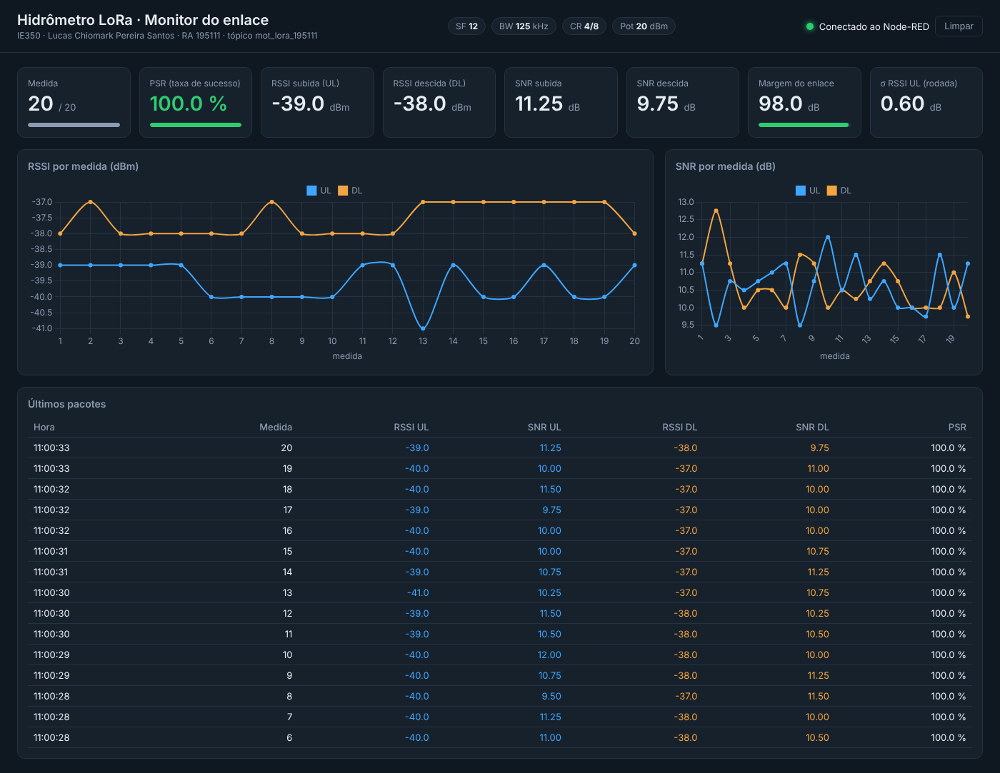

# Painel Node-RED do enlace LoRa

Tela web que mostra, em tempo real, os pacotes que passam pelo broker durante uma rodada:
RSSI e SNR nos dois sentidos, PSR, margem do enlace, σ da RSSI, gráficos por medida e
os últimos pacotes. Usa só nós nativos do Node-RED, sem paleta extra.

*Imagem: reprodução dos 20 pacotes da rodada de validação V1 (09/11).*

## Como usar

1. No Node-RED: menu ☰ → **Importar** → selecionar `painel_lora_nodered.json` → **Importar** → **Deploy**.
2. Abrir **http://localhost:1880/lora** no navegador.
3. Rodar o framework normalmente (N2/N3 + N6 → INICIAR). A tela zera sozinha quando começa uma rodada nova.

O PC com o Node-RED só precisa de internet: ele assina os mesmos tópicos do broker público
(`mot_lora_195111/gateway/uplink` e `.../downlink`), sem interferir no framework.

## Arquivos

| Arquivo | Conteúdo |
|---|---|
| `painel_lora_nodered.json` | Flow para importar (já contém tudo abaixo) |
| `fn_dl.js` / `fn_ul.js` | Código das functions que decodificam os 20 bytes |
| `painel.html` | Página da tela (Chart.js via CDN) |

PSR na tela = respostas UL válidas ÷ pacotes DL enviados desde a medida 1 da rodada.
Margem = menor RSSI (UL ou DL) − sensibilidade do SX1276 em SF12/BW125 (−137 dBm).
